# Wishtaday · 新版 12 人完整角色目录

**12 组配套素材已完成：8 女、4 男，共 24 张透明 PNG。**

每组包含用于个人对话框的高清形象，以及用于办公室的卡通三视图（正面站立、背面站立、背面坐姿）。通过同一 characterId 和 assetGroupId 关联；属于同一个人。

2026-11-04：8 位现有员工已按姓名和固定编号接入办公室：李婉儿、龙傲天、赵雅梦、叶凡、刘市、派阿奇、林幼薇、西罗。每人 3 张动作图集、24 帧；实习生保持原版。

许知宁、程知遥、苏映、沈清岚是储备角色，不自动新增员工。所有高清形象仍保留给未来个人对话框。技能、模型与真实业务数据不变。

[场景验证及回退说明](../../../docs/roster-library-update-2026-11-04.md) · [未来雇佣员工功能](../../../docs/employee-hiring-plan.md)

| 角色 | 岗位 | 气质 | 高清对话形象 | 卡通办公室形象 |
|---|---|---|---|---|
| 李婉儿 | 私人秘书 | 优雅干练 | [查看](li-waner/portrait-hd-transparent.png) | [查看](li-waner/compact-slim-transparent.png) |
| 许知宁 | 拓客部备选 | 自信明艳 | [查看](xu-zhining/portrait-hd-transparent.png) | [查看](xu-zhining/compact-slim-transparent.png) |
| 程知遥 | 程序部备选 | 冷静利落 | [查看](cheng-zhiyao/portrait-hd-transparent.png) | [查看](cheng-zhiyao/compact-slim-transparent.png) |
| 赵雅梦 | 资料室 | 知性温柔 | [查看](zhao-yameng/portrait-hd-transparent.png) | [查看](zhao-yameng/compact-slim-transparent.png) |
| 苏映 | 运营部备选 | 时髦有活力 | [查看](su-ying/portrait-hd-transparent.png) | [查看](su-ying/compact-slim-transparent.png) |
| 林幼薇 | 设计部 | 文艺清新 | [查看](lin-youwei/portrait-hd-transparent.png) | [查看](lin-youwei/compact-slim-transparent.png) |
| 派阿奇 | 合规部 | 成熟坚定 | [查看](pai-aqi/portrait-hd-transparent.png) | [查看](pai-aqi/compact-slim-transparent.png) |
| 沈清岚 | 市场调研备选 | 睿智从容 | [查看](shen-qinglan/portrait-hd-transparent.png) | [查看](shen-qinglan/compact-slim-transparent.png) |
| 龙傲天 | 程序部 | 冷静技术型 | [查看](long-aotian/portrait-hd-transparent.png) | [查看](long-aotian/compact-slim-transparent.png) |
| 叶凡 | 运营部 | 时髦创作型 | [查看](ye-fan/portrait-hd-transparent.png) | [查看](ye-fan/compact-slim-transparent.png) |
| 刘市 | 市场调研 | 知性研究型 | [查看](liu-shi/portrait-hd-transparent.png) | [查看](liu-shi/compact-slim-transparent.png) |
| 西罗 | 拓客部 | 自信商务型 | [查看](xi-luo/portrait-hd-transparent.png) | [查看](xi-luo/compact-slim-transparent.png) |

## 使用规则

- 高清与卡通必须按同一角色组使用，不能只按文件顺序或岗位名混用。
- 最终素材均为真实透明背景，棋盘格仅能作为查看器背景。
- 卡通版保留精致五官与角色气质，头大、身体和腿短，脸型避免过圆。
- 卡通图是三种静态姿态，不是可直接播放的动作图集；正式接入前仍需行走、转身、起身落座和工位遮挡验证。
- 员工岗位对应是设计记录，备选人物不代表已经新增或绑定业务员工。

## 逐人配套图

### 李婉儿 · 私人秘书

素材组：`li-waner-anime-v3`。优雅干练；深棕盘发、香槟白衬衫、黑包臀裙与黑丝袜。

已接入办公室的动作素材：[起身落座](li-waner/motion/sit-back.png)、[迈腿行走](li-waner/motion/walk.png)、[八向转身](li-waner/motion/turn.png)。每张 4×2 共 8 帧，透明背景；与下方高清和卡通设计保持同一角色组。表情动作暂沿用原版形象。

**高清版 · 个人对话框**

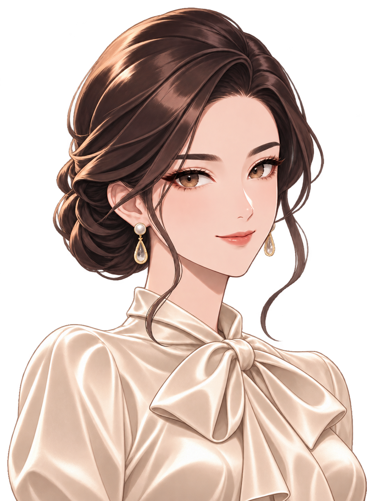

**卡通版 · 办公室**

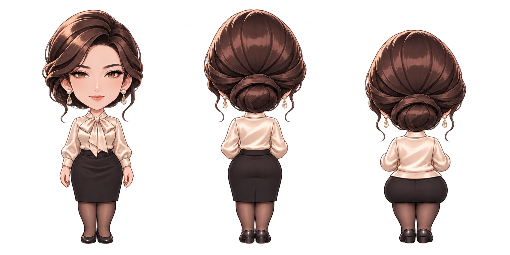

[原美术与服装设定（历史参考）](concepts/01-li-waner.png)

### 许知宁 · 拓客部备选

素材组：`xu-zhining-anime-v3`。自信明艳；黑色长卷发、宝石红连衣裙、金色长耳饰。

**高清版 · 个人对话框**

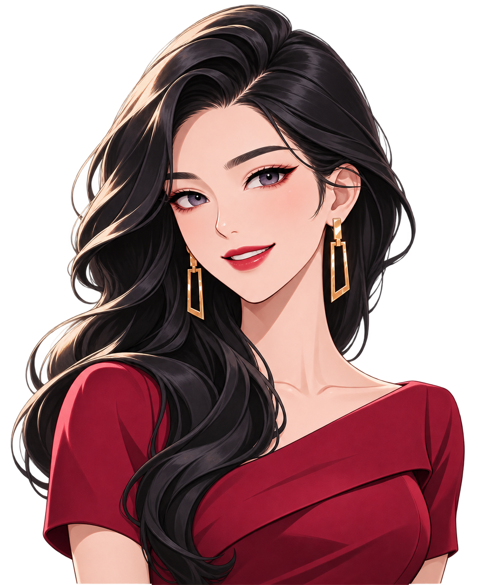

**卡通版 · 办公室**

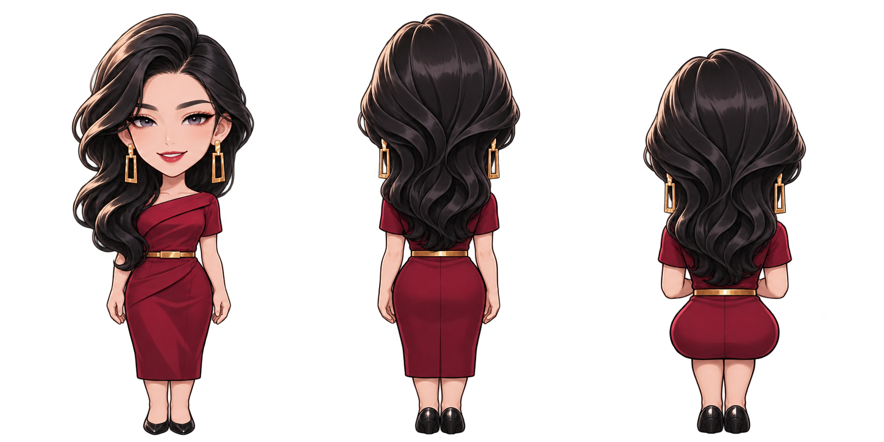

[原美术与服装设定（历史参考）](concepts/02-xu-zhining.png)

### 程知遥 · 程序部备选

素材组：`cheng-zhiyao-anime-v3`。冷静利落；蓝黑不对称短发、冰蓝上衣、墨蓝九分裤。

**高清版 · 个人对话框**

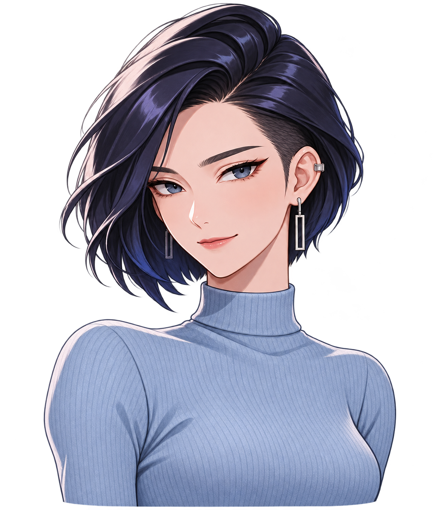

**卡通版 · 办公室**

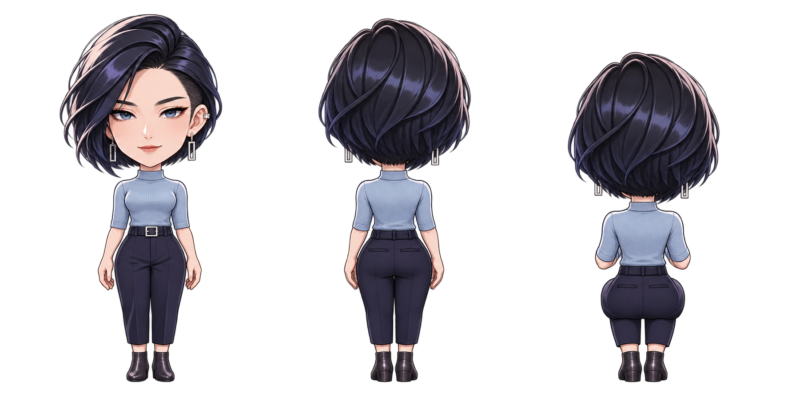

[原美术与服装设定（历史参考）](concepts/03-cheng-zhiyao.png)

### 赵雅梦 · 资料室

素材组：`zhao-yameng-anime-v3`。知性温柔；栗色侧辫、细金眼镜、紫灰针织与百褶裙。

已接入办公室：[起身落座](zhao-yameng/motion/sit-back.png)、[迈腿行走](zhao-yameng/motion/walk.png)、[八向转身](zhao-yameng/motion/turn.png)。与本人的高清/卡通图配对，特殊表情暂沿用原版。

**高清版 · 个人对话框**

**卡通版 · 办公室**

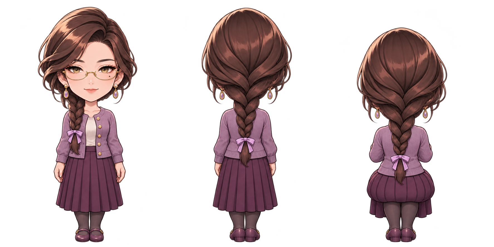

[原美术与服装设定（历史参考）](concepts/04-zhao-yameng.png)

### 苏映 · 运营部备选

素材组：`su-ying-anime-v3`。时髦有活力；铜红高马尾、奶油短外套、炭灰阔腿裤。

**高清版 · 个人对话框**

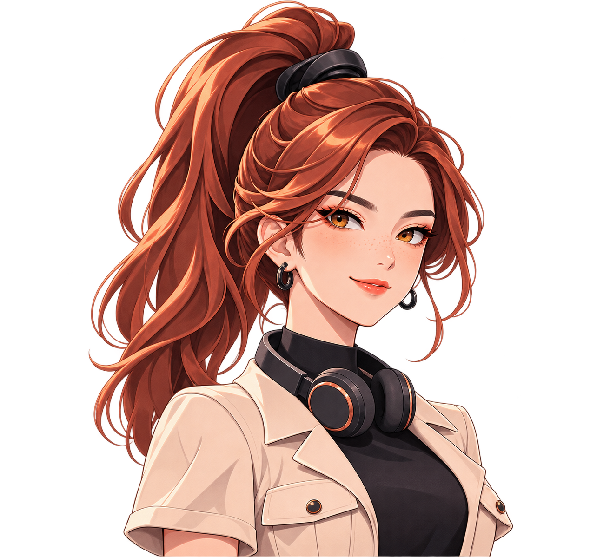

**卡通版 · 办公室**

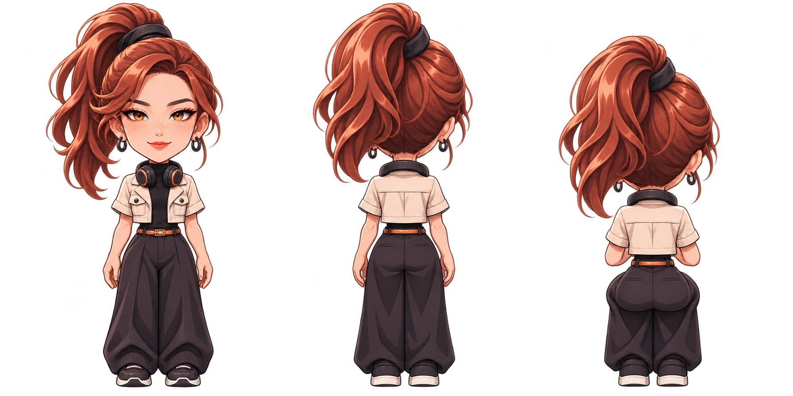

[原美术与服装设定（历史参考）](concepts/05-su-ying.png)

### 林幼薇 · 设计部

素材组：`lin-youwei-anime-v3`。文艺清新；亚麻棕卷发、青绿裹身裙、珊瑚耳饰。

已接入办公室：[起身落座](lin-youwei/motion/sit-back.png)、[迈腿行走](lin-youwei/motion/walk.png)、[八向转身](lin-youwei/motion/turn.png)。与本人的高清/卡通图配对，特殊表情暂沿用原版。

**高清版 · 个人对话框**

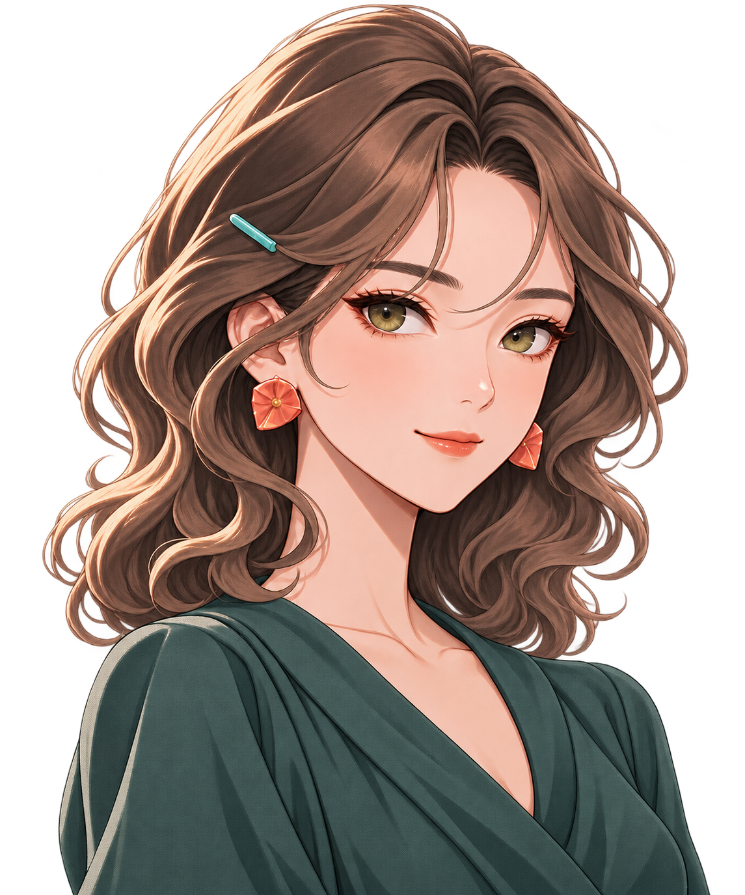

**卡通版 · 办公室**

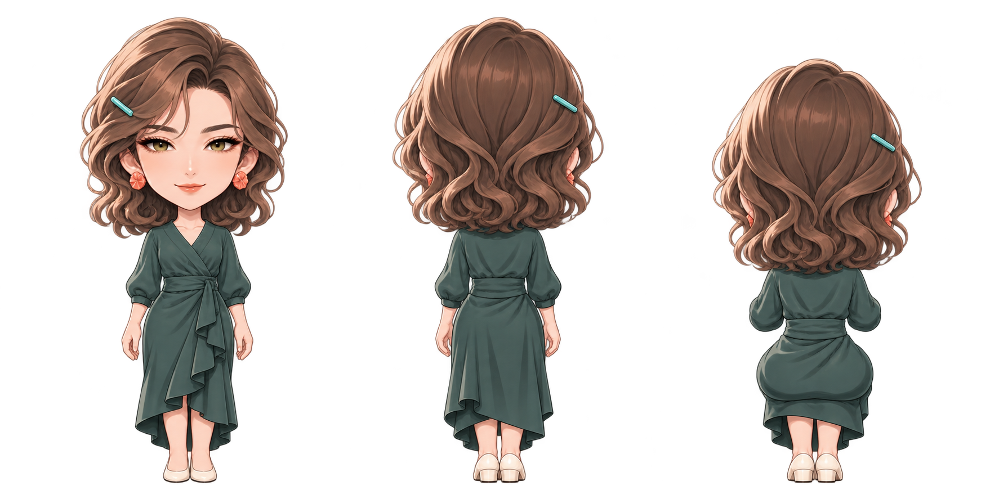

[原美术与服装设定（历史参考）](concepts/06-lin-youwei.png)

### 派阿奇 · 合规部

素材组：`pai-aqi-anime-v3`。成熟坚定；黑发高髻、墨绿双排扣长马甲、直筒裤。

已接入办公室：[起身落座](pai-aqi/motion/sit-back.png)、[迈腿行走](pai-aqi/motion/walk.png)、[八向转身](pai-aqi/motion/turn.png)。与本人的高清/卡通图配对，特殊表情暂沿用原版。

**高清版 · 个人对话框**

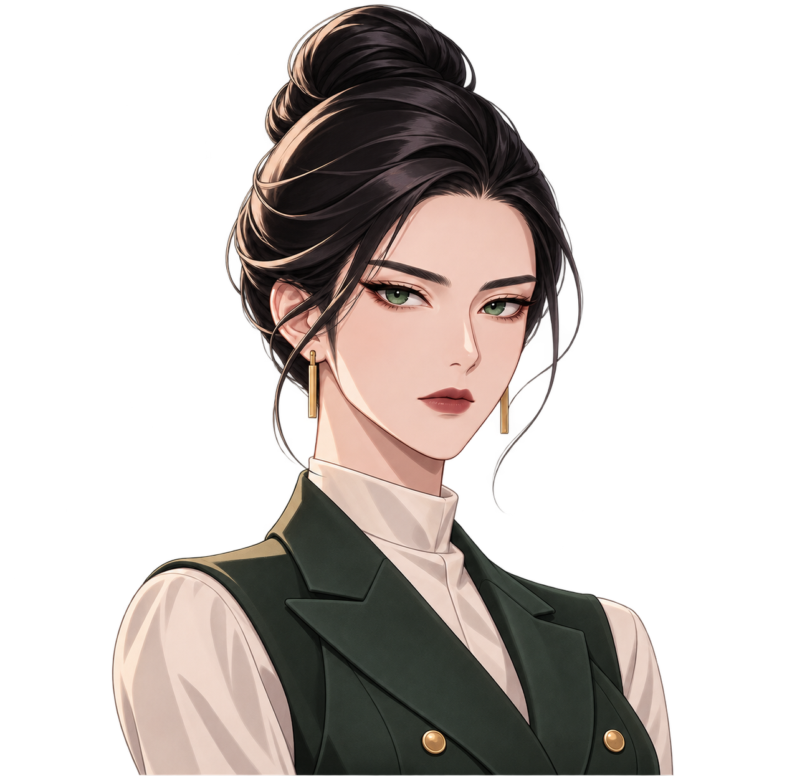

**卡通版 · 办公室**

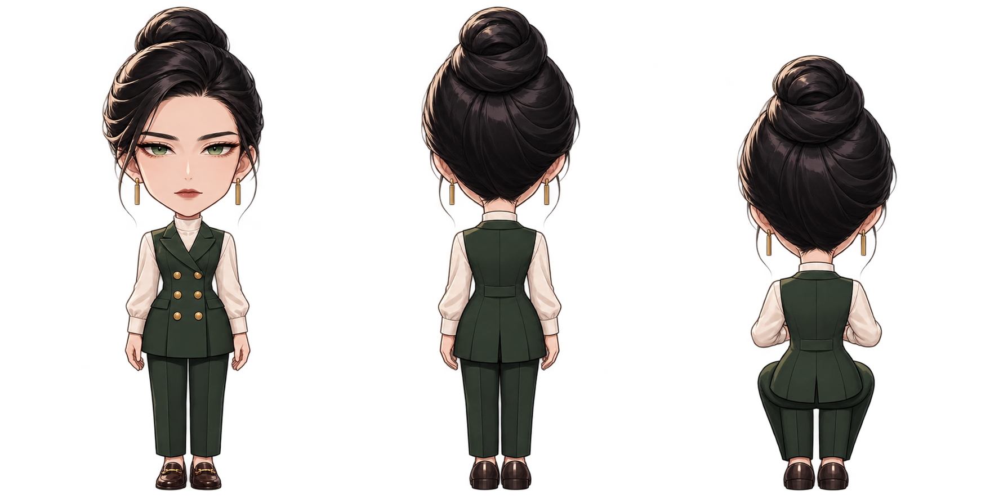

[原美术与服装设定（历史参考）](concepts/07-pai-aqi.png)

### 沈清岚 · 市场调研备选

素材组：`shen-qinglan-anime-v3`。睿智从容；烟棕齐肩直发、藏蓝衬衣、焦糖中长裙。

**高清版 · 个人对话框**

**卡通版 · 办公室**

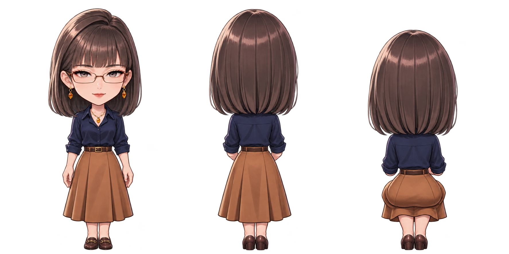

[原美术与服装设定（历史参考）](concepts/08-shen-qinglan.png)

### 龙傲天 · 程序部

素材组：`long-aotian-anime-v3`。冷静技术型；蓝黑侧分短发、冰蓝衬衫、石墨灰长裤。

已接入办公室：[起身落座](long-aotian/motion/sit-back.png)、[迈腿行走](long-aotian/motion/walk.png)、[八向转身](long-aotian/motion/turn.png)。与本人的高清/卡通图配对，特殊表情暂沿用原版。

**高清版 · 个人对话框**

**卡通版 · 办公室**

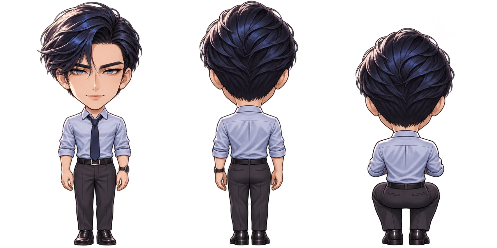

[原美术与服装设定（历史参考）](concepts/09-long-aotian.png)

### 叶凡 · 运营部

素材组：`ye-fan-anime-v3`。时髦创作型；铜棕蓬松发、奶油短夹克、黑色阔腿裤与耳机。

已接入办公室：[起身落座](ye-fan/motion/sit-back.png)、[迈腿行走](ye-fan/motion/walk.png)、[八向转身](ye-fan/motion/turn.png)。与本人的高清/卡通图配对，特殊表情暂沿用原版。

**高清版 · 个人对话框**

**卡通版 · 办公室**

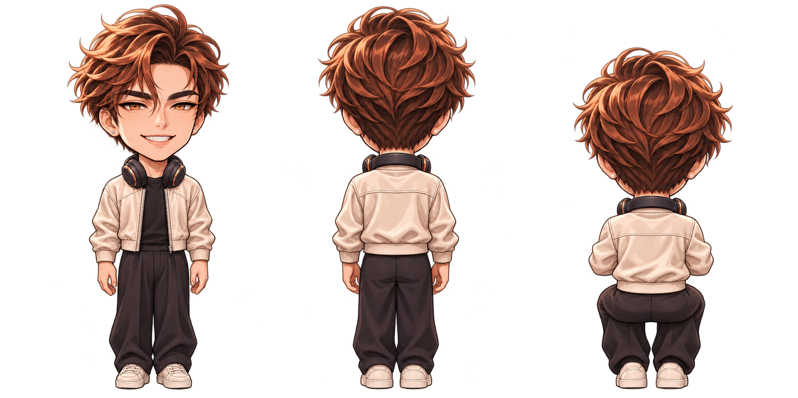

[原美术与服装设定（历史参考）](concepts/10-ye-fan.png)

### 刘市 · 市场调研

素材组：`liu-shi-anime-v3`。知性研究型；深棕微卷发、金属细框眼镜、烟棕马甲与米白衬衫。

已接入办公室：[起身落座](liu-shi/motion/sit-back.png)、[迈腿行走](liu-shi/motion/walk.png)、[八向转身](liu-shi/motion/turn.png)。与本人的高清/卡通图配对，特殊表情暂沿用原版。

**高清版 · 个人对话框**

**卡通版 · 办公室**

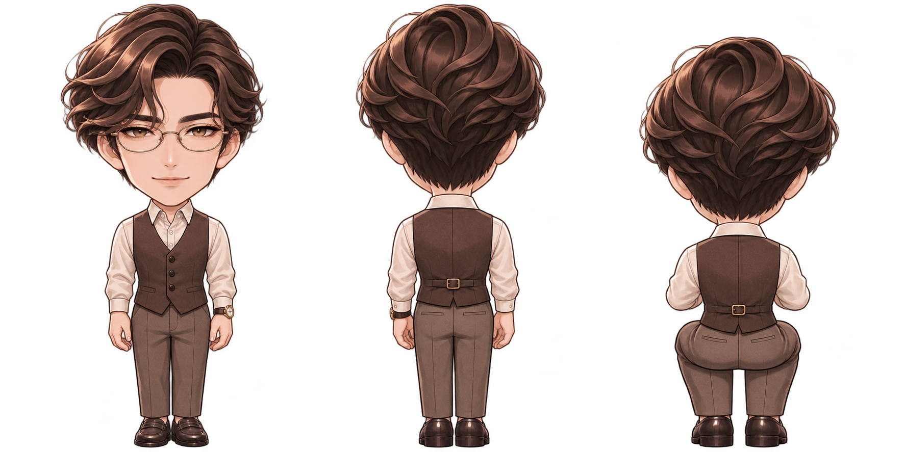

[原美术与服装设定（历史参考）](concepts/11-liu-shi.png)

### 西罗 · 拓客部

素材组：`xi-luo-anime-v3`。自信商务型；黑色后梳短发、海军蓝双排扣西装、酒红领带。

已接入办公室：[起身落座](xi-luo/motion/sit-back.png)、[迈腿行走](xi-luo/motion/walk.png)、[八向转身](xi-luo/motion/turn.png)。与本人的高清/卡通图配对，特殊表情暂沿用原版。

**高清版 · 个人对话框**

**卡通版 · 办公室**

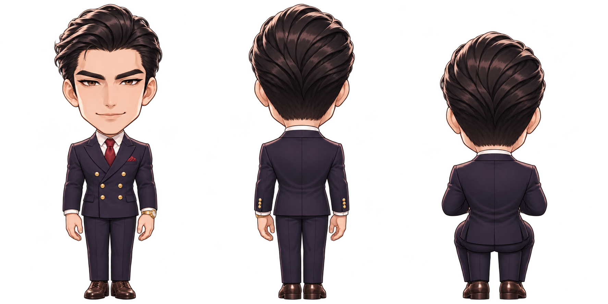

[原美术与服装设定（历史参考）](concepts/12-xi-luo.png)

## 校验与制作记录

- 内置 imagegen 制作；本批提示词与参考路径见 [batch-prompts.json](batch-prompts.json)，既有样板提示词见 [prompts.json](prompts.json)。
- [配对清单](manifest.json)包含文件路径、用途和生成来源。
- [透明度与完整性校验](paired-assets-verification.json)检查真实透明区域、PNG 完整性、24 个文件及 12 个素材组唯一性。
- 生成后逐张查看了人物外观、三姿态方向、服装和发型对应关系；本轮没有在办公室实际尺寸下运行，也没有验证动画。
- 旧目录与清单已备份到 history/before-full-pairs-*；旧图片未覆盖。

[设计规范](DESIGN_SPEC.md) · [返回角色库入口](../CATALOG.md)
