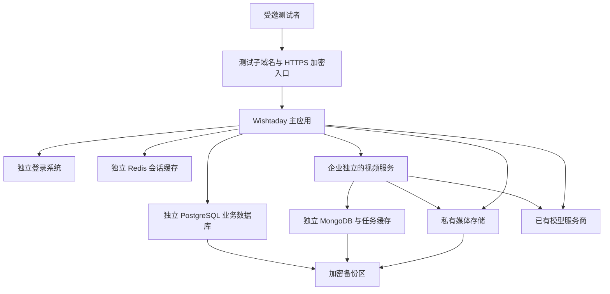

# 独立预发布环境部署方案与准备清单

日期：2026-10-26。性质：方案，未实施、未报价、未创建云资源、未修改 DNS（域名指向）。本轮只阅读代码、部署文档和官方资料；没有连接 AWS 账户核验资源，也没有运行部署或收费模型调用。

预发布环境就是一套与本机、未来正式环境分开的测试系统，用真实网址验证登录、任务和视频流程。建议第一轮只接待 3–5 名受邀测试者，先完成一个测试企业的完整流程，再完成第二个企业的隔离验收。这个人数是测试组织建议，不是容量承诺。

## 一、推荐方案

沿用项目已有的 AWS 部署方向，以香港区域作为候选，在 `staging.wishtaday.com` 建立独立环境。域名、区域及账号仍需确认，不能把历史记录当作今天已就绪的资源。AWS 官方当前列有香港 Cognito 用户池端点，但账号权限、邮件和实际用户网络仍需实测：[官方区域列表](https://docs.aws.amazon.com/general/latest/gr/cognito.html)。

建议复用现有基础设施代码的结构，单独建立 staging 参数、状态记录和发布入口；不要直接执行当前面向 production 的发布脚本。Terraform 是“按配置创建和管理云资源”的工具，其状态文件记录它管理的资源，预发布必须与正式环境分开。

图中是逻辑组件，不要求每个组件购买一台服务器。主应用用现有 ECS/Fargate（云端运行应用容器）路线；PostgreSQL、主应用 Redis 优先使用托管服务，减少自行维护；视频运行服务、MongoDB、专用 Redis 和代理会话先放在独立 Linux 工作机的隔离容器和持久磁盘上。不同企业的视频实例、凭据和数据空间必须分开，不能为了省钱把两个企业绑定到同一个服务地址。

| 部分 | 首轮建议 | 说明 |
| --- | --- | --- |
| 访问入口 | 测试子域名、HTTPS、受邀访问；保留正式域名现状 | 只有页面入口可被测试者访问，数据库、模型代理和内部制作服务不对公网开放 |
| 主应用 | 先单实例，备选起测规格 2 vCPU / 4 GiB | vCPU 是云服务器分配的计算核心；当前剪辑在主应用进程调用，资源不足时先降低并行数，再测是否扩容 |
| 视频服务 | 一个测试企业一套运行服务；备选工作机起测规格 4 vCPU / 8 GiB | 同时只放行少量生成和剪辑；第二个企业完整视频服务需重新核算资源。规格是实验起点，不是采购单 |
| 数据库与缓存 | 独立测试数据库、独立账号、加密连接；主应用账号不能绕过企业权限 | 不连接本机真实数据库，不复用本机登录会话；迁移管理员与应用账号分开 |
| 媒体 | 新建私有 S3 桶，禁止匿名读取；应用保持当前 5 分钟、当前会话绑定的访问方式 | S3 是云端文件存储；图片预览、上传和外部工具也必须适配，不能只把桶设私有就宣布完成 |
| 代理会话 | 持久磁盘保存，限制访问，纳入备份 | 容器被替换后仍能恢复任务；不能只放在临时目录 |
| 监控和备份 | 日志脱敏、存储期限、错误通知、每日备份、独立恢复演练 | 先验证能收到故障通知、能恢复，再邀请外部测试者 |

这些规格尚未经过 Linux 实测或采购报价。现阶段模型生成通过服务商接口完成，先不购买 GPU。若报价超出预算，可比较单台 Linux 主机集中部署的内部验证方案，但需要自行维护数据库加密、备份和故障恢复，且不能视为托管生产架构已经通过。

## 二、你需要准备什么

### 现在需要确定的五件事

| 需要你提供的信息 | 建议 | 是否现在要交密钥 |
| --- | --- | --- |
| 云账号方向 | 是否继续使用历史文档中的 AWS 账号，还是新建专门测试账号；优先独立测试账号，条件不足时同账号也要隔离所有资源 | 不需要。实施时用你控制的登录授权，不能在聊天粘贴云账号密钥 |
| 域名管理权限 | 是否继续使用 `wishtaday.com`，能否添加 `staging` 子域名；不必另买一个域名 | 不需要 |
| 预算上限 | 分别给出“每月云资源预算”和“本轮 AI 测试总额度”；也说明是否只在指定时段测试 | 不需要。预算数字是控制目标，不是报价 |
| 测试人群 | 第一批人数、主要所在地区、是否需要手机使用；建议先 3–5 人 | 先确认范围即可，邀请前再给邮箱名单 |
| 管理与告警邮箱 | 一个你能收信的邮箱，用于管理员、故障和预算通知 | 只需邮箱地址，不需要邮箱密码 |

### 实施前还要准备

- 少量可用于测试的素材：例如公开或自有的产品资料、文案、图片和短视频。建议从空库和合成数据开始，不整体上传真实聊天、客户资料或本机数据库。
- 模型测试凭据的使用方式：优先使用服务商允许的独立测试凭据和限额；如果只能复用已有凭据，需要在具体配置注入时确认权限与费用归属。保持现有模型名称、档位、路由和本机密钥不变；不要现在发 Key。
- 邀请邮件/密码找回的收信测试条件。初期先验证 Cognito 默认邮件是否满足受邀测试；需要自定义发信人时，再准备发信域名和 SES（AWS 邮件服务）验证，不能默认沙箱已能给任意收件人发信。[官方邮件说明](https://docs.aws.amazon.com/cognito/latest/developerguide/user-pool-email.html)
- 如果首批必须使用自动中文配音，需确定可用的 Linux 配音路线及授权/成本；不要求你现在购买配音服务。若暂缓，必须在测试范围内明确“自动配音未开放”，不能标为所有视频功能完成。

暂时不需要支付商户账号、支付宝/微信沙箱、社交平台发布授权、AgentCore、新模型或 GPU。这些不是当前预发布核心流程的前置条件；真实收费和对外发布继续保持关闭。

## 三、我需要先补齐的部署适配

下面是本次代码阅读确认的差距，尚未修改或云端实测。

| 差距及位置 | 要做的事情 | 完成标准 |
| --- | --- | --- |
| 当前镜像仅安装证书：`Dockerfile:12`；字幕查找 Linux 字体：`apps/api/src/operations/video-edit-render.mjs:251` | 加入 Linux 可用的 FFmpeg/ffprobe、中文字幕字体，验证编码能力和授权 | 容器中完成带中文字幕和配乐的剪辑，结果可播放和下载 |
| 主应用容器只读根目录且未定义工作目录挂载：`infra/terraform/modules/compute/main.tf:161` | 为临时剪辑、受保护运行配置安排明确的可写/只读挂载、权限和清理，不把所有目录改为可写 | 重启不丢持久记录；临时素材能清理；凭据不进入镜像 |
| 视频绑定由本地文件读取：`apps/api/src/operations/driver.mjs:7`；当前部署环境变量缺少该文件挂载 | 生成只属于预发布的新运行注册表、安全注入、内部地址及健康检查 | 云端主应用能找到正确企业的视频服务；不同企业拒绝共用同一实例 |
| 现有基础设施没有接齐视频服务、MongoDB、媒体和代理会话 | 增加独立视频部署单元及持久存储，保持已修复的代理认证和日志脱敏 | 从创建任务到视频下载和归档在云端走通；重启后任务、会话和文件仍在 |
| 配音仅支持 Mac：`apps/api/src/operations/video-narration.mjs:10` | 在独立配置下适配 Linux 配音，或明确列为首轮不开放功能 | 不出现“有按钮但调用就报 Mac 限制”；不能未经确认替换现有模型配置 |
| 发布脚本固定目录/账号/区域：`scripts/cloud-release.mjs:8`，迁移脚本也读同一状态目录 | 增加 staging 专用参数、独立 Terraform 后端状态和资源命名；避免修改 production 状态 | 变更计划仅包含测试资源，不改变正式根域、本机资源或已有业务数据库 |
| 当前用户池没有明确仅管理员创建用户设置：`infra/terraform/modules/identity/main.tf:6` | 配置仅受邀注册/创建用户，并验证应用业务入口同样受控；测试管理员启用适当额外认证 | 未受邀用户不能开通业务、消耗模型额度；邀请、登录、找回密码、退出闭环 |
| 当前本地视频桶策略不是整桶私有；新云环境使用完全私有素材桶 | 验证 S3 权限、上传、图片显示、原片/成片读取、第三方服务临时读取；不复用公开读策略 | 无登录读不到素材；视频临时链接到期/撤销生效；正常图片和视频操作不损坏 |
| 云发布链路尚未验证大文件/长请求/Range | 验证代理超时、分段读取、Cookie/来源校验、不缓存私有 API，检查日志不记录完整临时链接 | 进度拖动、长任务状态、下载重试正常；没有跨用户缓存 |
| 当前备份脚本针对原生 Mac：`docs/backup-and-restore.md` | 增加云端数据库、媒体、代理会话和配置备份；密钥与数据备份分权限保存 | 在独立目标恢复，记录表数量、文件校验和恢复耗时，不覆盖运行环境 |

Fargate 临时存储与持久存储不同，数据库或会话不能因为“容器有磁盘”就当成已持久化；具体选择以部署路径为准。[AWS 存储说明](https://docs.aws.amazon.com/AmazonECS/latest/developerguide/using_data_volumes.html)

新云桶建议保持 S3 全部公共访问阻止选项开启。[AWS 官方说明](https://docs.aws.amazon.com/AmazonS3/latest/userguide/configuring-block-public-access-bucket.html) 浏览器继续经过本应用的会话校验，不直接用“谁拿到都可读”的存储签名链接替代当前保护；确有外部工具要读取时，另设限对象、短有效期的授权并验收。

## 四、环境隔离与数据处理

1. 测试域名、登录用户池、数据库、Redis、媒体桶、代理会话、内部服务密钥、运行注册表、备份前缀和 Terraform 状态全部独立。优先独立 AWS 账号；同账号时仍需独立网络、权限和资源命名，不能只改一个标签。
2. 从空的测试数据库开始。办公室动画使用现有代码，员工岗位和技能绑定保持原关系；只在后续获准时导入必要的配置副本，不复制全量真实业务数据和本机会话。
3. 模型配置原件只读。新环境的内部 bridge/JWT/源站密钥可以独立生成，但不能轮换本机现有值。若复制已加密的模型配置，必须由受控迁移程序正确解密再使用测试环境主密钥加密，或按独立测试凭据重新配置；不能复制密文后随意换主密钥。此操作本轮未做。
4. 预发布执行任务独立记账，先禁用真实付费任务，用合成视频验证登录、剪辑和归档；再在明确额度内做一次完整真实生成。失败或结果未知时，不自动重复收费提交。
5. 不把 Mac 当作云端后台转发机，不开放本机视频/数据库端口，不迁移本机真实任务。停止或销毁测试资源前保留必要备份，不能误删共享域名和账号资源。

## 五、部署和验收顺序

| 阶段 | 动作 | 通过后才做下一步 |
| --- | --- | --- |
| 1. 核对与报价 | 确认上述五项信息；只读核查账号、区域、域名、配额；给出逐项费用和资源变更预览 | 你看过具体资源、预算和域名变更后确认购买/创建 |
| 2. 本地准备部署包 | 完成 Linux 工具、运行配置注入、独立 staging 脚本、持久目录和注册限制；先跑隔离测试 | 生产启动检查、镜像测试和核心回归通过，不修改现有配置 |
| 3. 创建独立基础设施 | 新数据库/缓存/私有素材桶/身份/密钥/备份/工作机；迁移空库；启动固定版本镜像 | 健康检查通过，内部端口不公开，缺少配置会拒绝启动 |
| 4. 测试网址联调 | HTTPS、邀请/登录/找回密码、权限、现有素材剪辑和下载归档 | 未登录拒绝、跨企业拒绝、链接过期/撤销、文件校验均通过 |
| 5. 受控真实任务 | 依照单独测试额度，从需求到生成、预览、下载和归档；两家测试企业验证隔离 | 任务费用可核对，失败可恢复，不重复收费，不发布视频 |
| 6. 故障与恢复 | 应用重启、视频工作机重启、缓存故障、备份恢复、回退旧镜像；真实用户网络测一次完整流程 | 任务/文件保留；会话必要时重新登录；有故障通知和恢复记录 |
| 7. 邀请测试 | 列出已开放功能、已知限制、测试名单和结束日期 | 你确认后开放给这批人；不等同公开上线或商业收费完成 |

现有许可门槛保持，镜像及素材授权在邀请前核对，不通过强行设置“已审阅”来绕过；本轮不更改办公室动画。升级使用固定镜像版本，数据库迁移先备份且保持旧版本兼容；回退程序不等于自动回退数据库。

建议起始备份目标为“最多丢失 24 小时测试数据、4 小时内恢复”，这只是待验收目标，不是已实现承诺。每天备份并至少保留 7 天；新增表、媒体、会话和主密钥纳入完整恢复演练，密钥单独限制访问。重要测试任务完成后追加备份。

## 六、预算怎么控制

旧部署文档中的月费是历史、部分服务的估算，不能作为本方案报价；尤其没有完整覆盖当前视频服务。当前账户费用、余额、可用额度以及 4yi 实际采购价均未核查。

确认预算后再用 [AWS 官方费用计算器](https://calculator.aws/) 列出：主应用、视频工作机、数据库、缓存、负载均衡、网络出口、媒体存储/流量、镜像、日志、备份、邮件与税费；AI 文本/图片/视频费用另列。单实例节省冗余但可能中断测试，不承诺正式服务可用性。

建议设置预算 50%/80%/100% 通知，配合应用侧任务额度、允许测试时段和并行限制。AWS 账单通知存在延迟，**预算告警不是实时硬停机或绝不超支保证**；即使应用关掉，数据库、磁盘和网络等仍可能收费。[AWS 预算限制说明](https://docs.aws.amazon.com/cost-management/latest/userguide/budgets-managing-costs.html)

## 七、本轮结论

本地功能已具备预发布准备基础，但现有云部署包还不能直接代表完整视频商品可用。下一步先确定云账号、测试域名、两类预算、测试人群和通知邮箱，再补部署适配和具体报价。办公室动画、员工技能绑定和模型配置本轮均未修改；没有创建资源、发布网站或新增模型费用。
